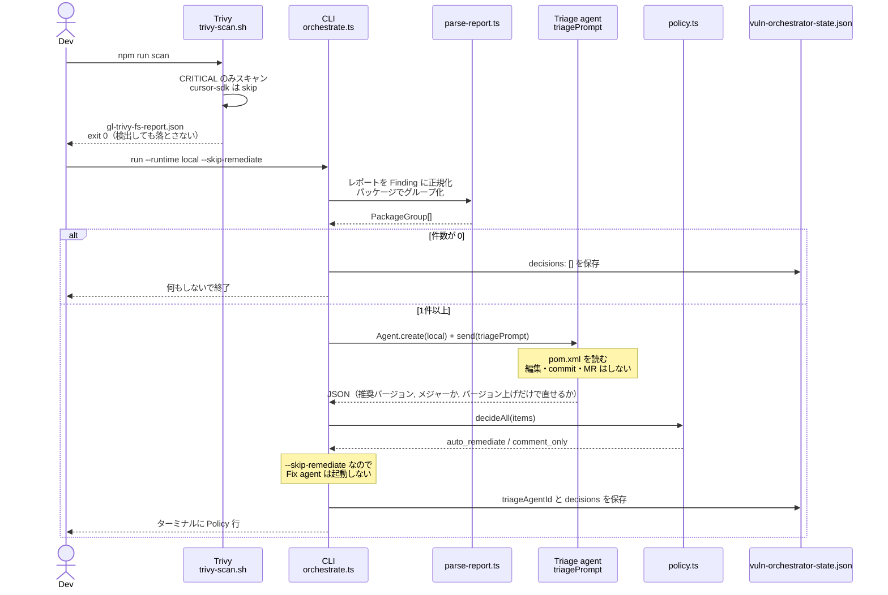
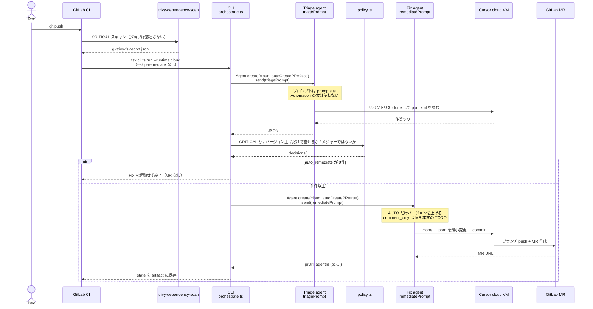
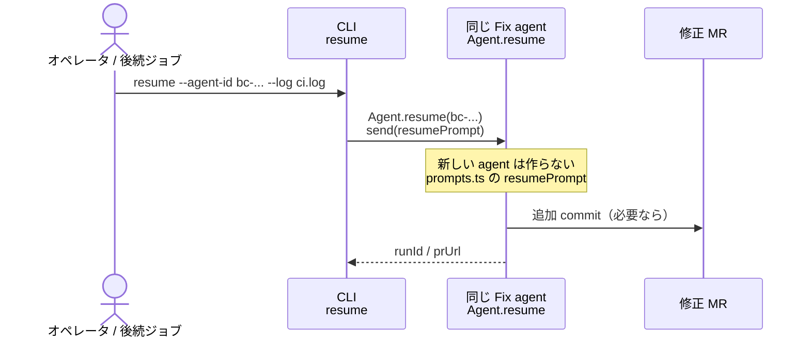
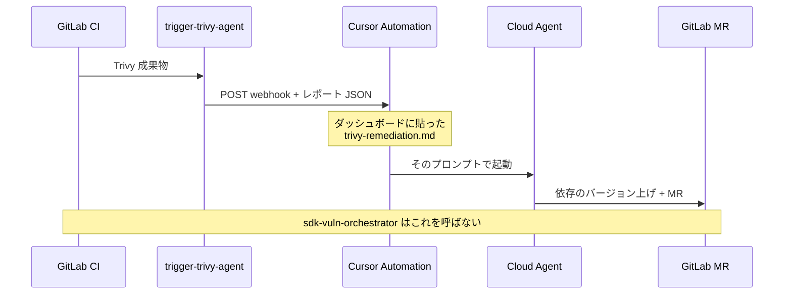
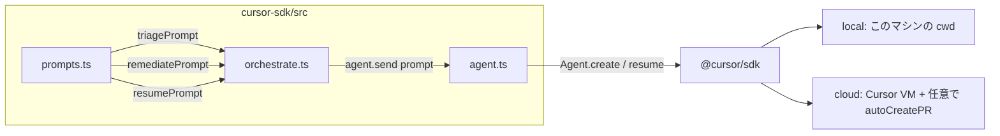

# 脆弱性オーケストレータ シーケンス

English: [SEQUENCE.md](./SEQUENCE.md)

使い方: [USAGE.ja.md](./USAGE.ja.md) / 構成: [ARCHITECTURE.ja.md](./ARCHITECTURE.ja.md)

プロンプトはすべて `src/prompts.ts` から `agent.send()` に渡します。Cursor Automation に貼った文は、この SDK 経路では使われません。

## 登場するもの

| 略称 | 実体 | SDK か |
| --- | --- | --- |
| Dev | 手元の開発者 | いいえ |
| Trivy | `scripts/trivy-scan.sh` または CI の `trivy-dependency-scan` | いいえ |
| CLI | `cli.ts` → `orchestrate.ts` | 呼び出し元 |
| Policy | `policy.ts` | いいえ |
| Triage | Cursor Agent（`triagePrompt`） | はい |
| Fix | Cursor Agent（`remediatePrompt`） | はい |
| GitLab | リポジトリ / MR | いいえ |
| Automation | Cursor Automation + `trigger-trivy-agent` | いいえ（別経路） |

---

## 1. ローカル（MR は開かない）

推奨コマンド: `cd cursor-sdk && npm run scan:run`  
（`--runtime local --skip-remediate`）

このあと MR は開きません。`remediationAgentId` も書きません。

---

## 2. CI（Policy を通ったものだけ MR）

人が `--runtime cloud` を叩く必要はありません。push かつ `CURSOR_API_KEY` があるとき、`sdk-vuln-orchestrator` が実行します。

Policy の中身は次のすべてを満たすときだけ `auto_remediate` です。

1. 重大度が CRITICAL
2. バージョンを上げるだけで直せる（`recommendedVersion` あり）
3. メジャーバージョン上げではない（先頭の数字が上がらない）

MR 本文は TypeScript が書いていません。`remediatePrompt` を読んだ Fix agent が書きます。

---

## 3. 修正 MR の CI が落ちたあと（resume）

元の Trivy ジョブが赤でも resume しません。対象は修正ブランチの build/test 失敗か、エージェント run の失敗です。

ローカルのトリアージだけ回した state には `remediationAgentId` が無いので、この経路には使えません。

---

## 4. 使っていない経路（Cursor Automation）

SDK ジョブとは別物です。`CURSOR_TRIVY_WEBHOOK_URL` が残っていると、こちらも動いて MR が二重になります。

| 経路 | プロンプト | MR を開くか |
| --- | --- | --- |
| ローカル `scan:run` | `triagePrompt` のみ | 開かない |
| CI `sdk-vuln-orchestrator` | `triagePrompt` のあと、通れば `remediatePrompt` | Policy 通過時だけ |
| CI `trigger-trivy-agent` | Automation の markdown | Automation 側の設定次第 |

---

## プロンプトが渡る位置

