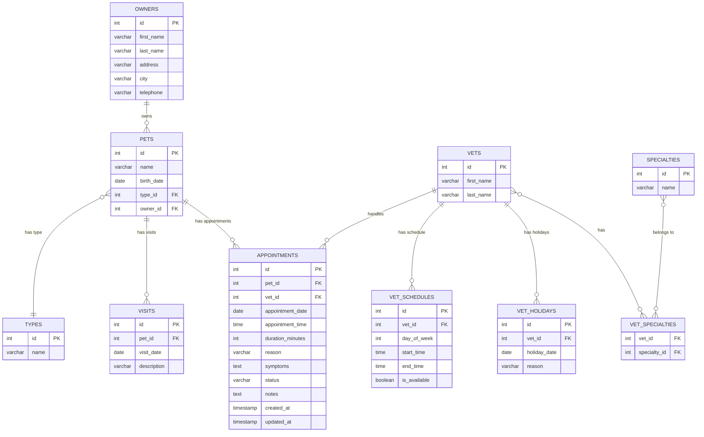
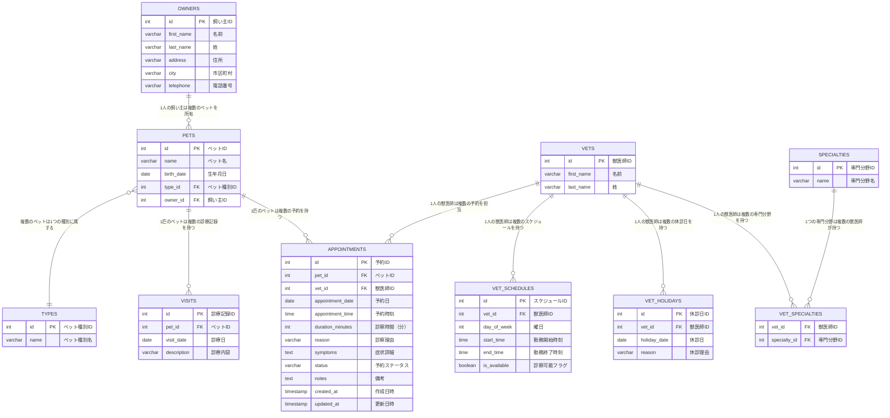
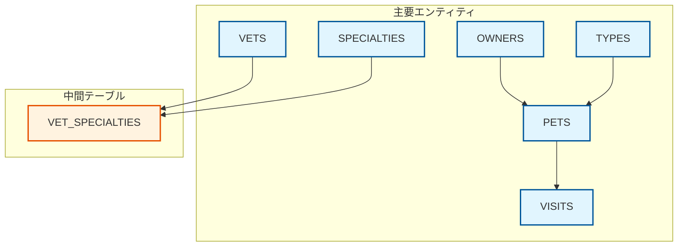
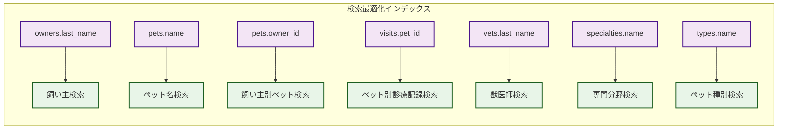
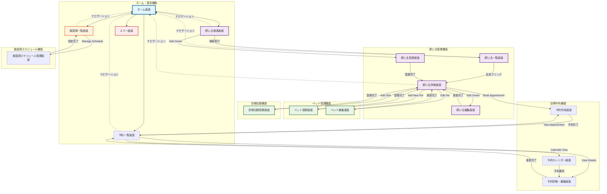
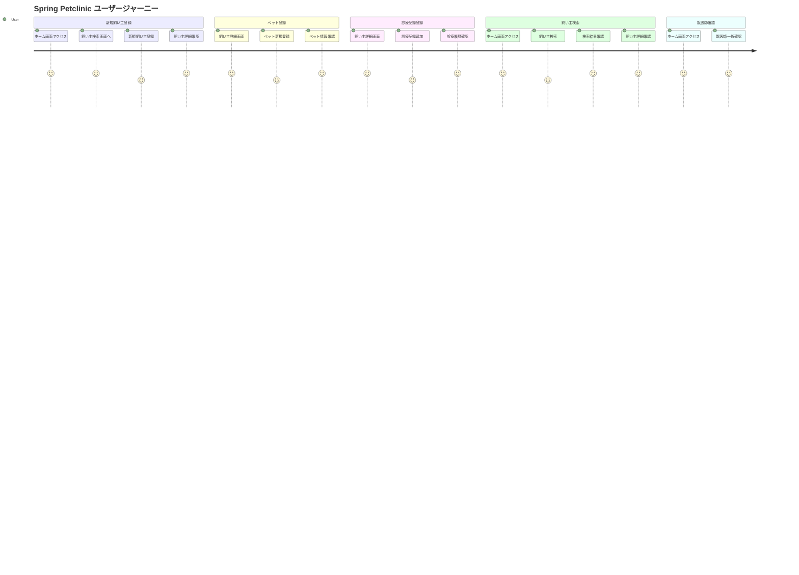
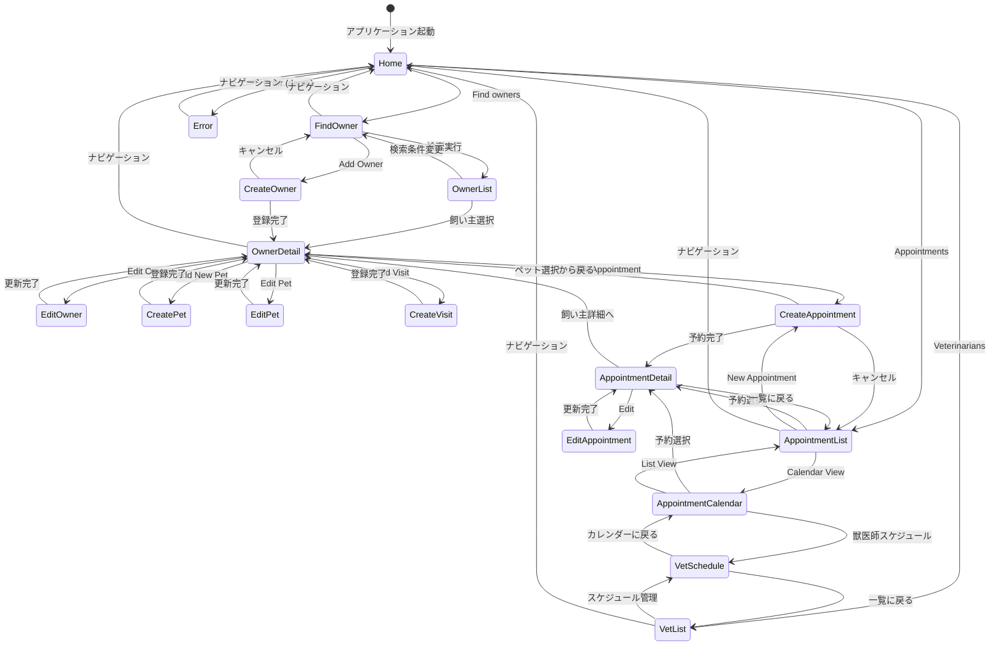
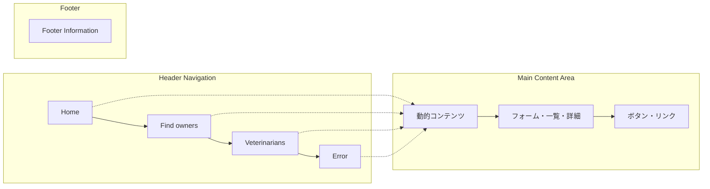

# Spring Petclinic プロジェクト解析書

## 1. 画面一覧

### 1.1 メイン画面
| 画面ID | 画面名 | URL | 機能概要 |
|--------|--------|-----|----------|
| TOP001 | ホーム画面 | `/` | アプリケーションのホーム画面 |
| ERR001 | エラー画面 | `/oups` | システムエラー表示画面 |

### 1.2 飼い主管理画面
| 画面ID | 画面名 | URL | 機能概要 |
|--------|--------|-----|----------|
| OWN001 | 飼い主検索画面 | `/owners/find` | 飼い主の検索フォーム |
| OWN002 | 飼い主一覧画面 | `/owners` | 検索結果の飼い主一覧表示 |
| OWN003 | 飼い主登録・更新画面 | `/owners/new`, `/owners/{id}/edit` | 飼い主の新規登録・更新フォーム |
| OWN004 | 飼い主詳細画面 | `/owners/{id}` | 飼い主の詳細情報とペット一覧 |

### 1.3 ペット管理画面
| 画面ID | 画面名 | URL | 機能概要 |
|--------|--------|-----|----------|
| PET001 | ペット登録・更新画面 | `/owners/{ownerId}/pets/new`, `/owners/{ownerId}/pets/{petId}/edit` | ペットの新規登録・更新フォーム |
| PET002 | 診療記録登録画面 | `/owners/{ownerId}/pets/{petId}/visits/new` | ペットの診療記録登録フォーム |

### 1.4 獣医師管理画面
| 画面ID | 画面名 | URL | 機能概要 |
|--------|--------|-----|----------|
| VET001 | 獣医師一覧画面 | `/vets.html` | 獣医師一覧表示 |

### 1.5 診察予約管理画面
| 画面ID | 画面名 | URL | 機能概要 |
|--------|--------|-----|----------|
| APP001 | 予約一覧画面 | `/appointments` | 予約の検索・一覧表示 |
| APP002 | 予約作成画面 | `/appointments/new` | 新規予約の作成フォーム |
| APP003 | 予約詳細・編集画面 | `/appointments/{id}` | 予約内容の確認・編集 |
| APP004 | 予約カレンダー画面 | `/appointments/calendar` | カレンダー形式での予約表示 |
| APP005 | 獣医師スケジュール管理画面 | `/vets/{id}/schedule` | 獣医師の勤務時間・休診日設定 |

## 2. テーブル一覧

### 2.1 テーブル概要
| テーブル名 | 日本語名 | 説明 |
|-----------|----------|------|
| owners | 飼い主 | ペットの飼い主情報を管理 |
| pets | ペット | ペットの基本情報を管理 |
| visits | 診療記録 | ペットの診療記録を管理 |
| types | ペット種別 | ペットの種類（犬、猫等）を管理 |
| vets | 獣医師 | 獣医師の基本情報を管理 |
| specialties | 専門分野 | 獣医師の専門分野を管理 |
| vet_specialties | 獣医師専門分野 | 獣医師と専門分野の関連を管理 |
| appointments | 診察予約 | ペットの診察予約情報を管理 |
| vet_schedules | 獣医師スケジュール | 獣医師の勤務時間を管理 |
| vet_holidays | 獣医師休診日 | 獣医師の休診日を管理 |

### 2.2 テーブル詳細

#### 2.2.1 owners（飼い主）
| カラム名 | データ型 | 制約 | 説明 |
|----------|----------|------|------|
| id | INTEGER | PRIMARY KEY, AUTO_INCREMENT | 飼い主ID |
| first_name | VARCHAR(30) | NOT NULL | 名前 |
| last_name | VARCHAR(30) | NOT NULL | 姓 |
| address | VARCHAR(255) | - | 住所 |
| city | VARCHAR(80) | - | 市区町村 |
| telephone | VARCHAR(20) | - | 電話番号 |

#### 2.2.2 pets（ペット）
| カラム名 | データ型 | 制約 | 説明 |
|----------|----------|------|------|
| id | INTEGER | PRIMARY KEY, AUTO_INCREMENT | ペットID |
| name | VARCHAR(30) | NOT NULL | ペット名 |
| birth_date | DATE | - | 生年月日 |
| type_id | INTEGER | NOT NULL, FK | ペット種別ID |
| owner_id | INTEGER | NOT NULL, FK | 飼い主ID |

#### 2.2.3 visits（診療記録）
| カラム名 | データ型 | 制約 | 説明 |
|----------|----------|------|------|
| id | INTEGER | PRIMARY KEY, AUTO_INCREMENT | 診療記録ID |
| pet_id | INTEGER | NOT NULL, FK | ペットID |
| visit_date | DATE | - | 診療日 |
| description | VARCHAR(255) | - | 診療内容 |

#### 2.2.4 types（ペット種別）
| カラム名 | データ型 | 制約 | 説明 |
|----------|----------|------|------|
| id | INTEGER | PRIMARY KEY, AUTO_INCREMENT | ペット種別ID |
| name | VARCHAR(80) | NOT NULL | ペット種別名 |

#### 2.2.5 vets（獣医師）
| カラム名 | データ型 | 制約 | 説明 |
|----------|----------|------|------|
| id | INTEGER | PRIMARY KEY, AUTO_INCREMENT | 獣医師ID |
| first_name | VARCHAR(30) | NOT NULL | 名前 |
| last_name | VARCHAR(30) | NOT NULL | 姓 |

#### 2.2.6 specialties（専門分野）
| カラム名 | データ型 | 制約 | 説明 |
|----------|----------|------|------|
| id | INTEGER | PRIMARY KEY, AUTO_INCREMENT | 専門分野ID |
| name | VARCHAR(80) | NOT NULL | 専門分野名 |

#### 2.2.7 vet_specialties（獣医師専門分野）
| カラム名 | データ型 | 制約 | 説明 |
|----------|----------|------|------|
| vet_id | INTEGER | NOT NULL, FK | 獣医師ID |
| specialty_id | INTEGER | NOT NULL, FK | 専門分野ID |

#### 2.2.8 appointments（診察予約）
| カラム名 | データ型 | 制約 | 説明 |
|----------|----------|------|------|
| id | INTEGER | PRIMARY KEY, AUTO_INCREMENT | 予約ID |
| pet_id | INTEGER | NOT NULL, FK | ペットID |
| vet_id | INTEGER | NOT NULL, FK | 獣医師ID |
| appointment_date | DATE | NOT NULL | 予約日 |
| appointment_time | TIME | NOT NULL | 予約時刻 |
| duration_minutes | INTEGER | DEFAULT 30 | 診察時間（分） |
| reason | VARCHAR(255) | - | 診察理由 |
| symptoms | TEXT | - | 症状詳細 |
| status | VARCHAR(20) | DEFAULT 'PENDING' | 予約ステータス |
| notes | TEXT | - | 備考 |
| created_at | TIMESTAMP | DEFAULT CURRENT_TIMESTAMP | 作成日時 |
| updated_at | TIMESTAMP | DEFAULT CURRENT_TIMESTAMP | 更新日時 |

#### 2.2.9 vet_schedules（獣医師スケジュール）
| カラム名 | データ型 | 制約 | 説明 |
|----------|----------|------|------|
| id | INTEGER | PRIMARY KEY, AUTO_INCREMENT | スケジュールID |
| vet_id | INTEGER | NOT NULL, FK | 獣医師ID |
| day_of_week | INTEGER | NOT NULL | 曜日（0=日曜、1=月曜...） |
| start_time | TIME | NOT NULL | 勤務開始時刻 |
| end_time | TIME | NOT NULL | 勤務終了時刻 |
| is_available | BOOLEAN | DEFAULT TRUE | 診察可能フラグ |

#### 2.2.10 vet_holidays（獣医師休診日）
| カラム名 | データ型 | 制約 | 説明 |
|----------|----------|------|------|
| id | INTEGER | PRIMARY KEY, AUTO_INCREMENT | 休診日ID |
| vet_id | INTEGER | NOT NULL, FK | 獣医師ID |
| holiday_date | DATE | NOT NULL | 休診日 |
| reason | VARCHAR(255) | - | 休診理由 |

### 2.3 ER図（Entity Relationship Diagram）

#### 2.3.1 基本的なER図



#### 2.3.2 詳細なER図（カーディナリティ付き）



#### 2.3.3 関係性の詳細

| 関係 | カーディナリティ | 説明 |
|------|------------------|------|
| OWNERS ↔ PETS | 1:N | 1人の飼い主は複数のペットを所有できる |
| PETS ↔ TYPES | N:1 | 複数のペットは1つの種別に属する |
| PETS ↔ VISITS | 1:N | 1匹のペットは複数の診療記録を持つ |
| PETS ↔ APPOINTMENTS | 1:N | 1匹のペットは複数の予約を持つ |
| VETS ↔ APPOINTMENTS | 1:N | 1人の獣医師は複数の予約を担当する |
| VETS ↔ VET_SCHEDULES | 1:N | 1人の獣医師は複数のスケジュールを持つ |
| VETS ↔ VET_HOLIDAYS | 1:N | 1人の獣医師は複数の休診日を持つ |
| VETS ↔ SPECIALTIES | N:N | 獣医師と専門分野は多対多の関係 |

#### 2.3.4 外部キー制約



#### 2.3.5 インデックス構成



### 2.4 データベース設計の特徴

#### 🎯 **正規化レベル**
- **第3正規形（3NF）**まで正規化済み
- **データの整合性**が保たれている
- **更新異常・削除異常**を防止

#### 🔗 **関係性設計**
- **1対多関係**: owners→pets、pets→visits、types→pets
- **多対多関係**: vets↔specialties（中間テーブル経由）
- **参照整合性**: 外部キー制約で データの整合性を保証

#### 📊 **パフォーマンス最適化**
- **検索頻度の高いカラム**にインデックス配置
- **ページネーション**に対応した設計
- **適切なデータ型**選択による容量最適化

#### 🛡️ **データ品質**
- **主キー制約**: 全テーブルで一意性保証
- **外部キー制約**: 参照整合性の保証
- **NOT NULL制約**: 必須データの保証

## 3. クラス図

### 3.1 エンティティクラス図

```
BaseEntity
├── NamedEntity
│   ├── Pet
│   ├── PetType
│   └── Specialty
├── Person
│   ├── Owner
│   └── Vet
├── Visit
├── Appointment
├── VetSchedule
└── VetHoliday
```

### 3.2 主要クラスの関係性

```
Owner (1) ←─→ (n) Pet (n) ←─→ (1) PetType
                 ↓
               Visit (n)
                 ↓
            Appointment (n) ←─→ (1) Vet (1) ←─→ (n) VetSchedule
                                     ↓
                                VetHoliday (n)
                                     ↓
                              VetSpecialty (n) ←─→ (1) Specialty

関係性の詳細:
- Owner と Pet: 1対多（1人の飼い主が複数のペット所有）
- Pet と PetType: 多対1（複数のペットが1つの種別に属する）
- Pet と Visit: 1対多（1匹のペットが複数の診療記録を持つ）
- Pet と Appointment: 1対多（1匹のペットが複数の予約を持つ）
- Vet と Appointment: 1対多（1人の獣医師が複数の予約を担当）
- Vet と VetSchedule: 1対多（1人の獣医師が複数のスケジュールを持つ）
- Vet と VetHoliday: 1対多（1人の獣医師が複数の休診日を持つ）
- Vet と Specialty: 多対多（VetSpecialtyを介した関係）
```

### 3.3 コントローラクラス構成

```
@Controller
├── OwnerController
│   ├── 飼い主検索・一覧・詳細
│   ├── 飼い主登録・更新
│   └── ページネーション
├── PetController
│   ├── ペット登録・更新
│   └── バリデーション
├── VisitController
│   └── 診療記録登録
├── AppointmentController
│   ├── 予約一覧・検索
│   ├── 予約作成・更新・削除
│   ├── 予約ステータス管理
│   └── カレンダー表示
├── ScheduleController
│   ├── 獣医師スケジュール管理
│   ├── 勤務時間設定
│   └── 休診日管理
├── VetController
│   └── 獣医師一覧
└── WelcomeController
    └── ホーム画面
```

## 4. 各画面の基本設計書

### 4.1 ホーム画面（TOP001）

#### 4.1.1 画面概要
- **画面ID**: TOP001
- **画面名**: ホーム画面
- **URL**: `/`
- **機能**: アプリケーションのホーム画面

#### 4.1.2 画面レイアウト
```
┌─────────────────────────────────────┐
│ Spring Petclinic                   │
│ [Home] [Find owners] [Vets] [Error] │
├─────────────────────────────────────┤
│                                     │
│      Welcome to Petclinic          │
│                                     │
│        [ペット画像]                 │
│                                     │
└─────────────────────────────────────┘
```

#### 4.1.3 機能詳細
- ウェルカムメッセージ表示
- ペット画像表示
- ナビゲーションメニューから各機能へのアクセス

### 4.2 飼い主検索画面（OWN001）

#### 4.2.1 画面概要
- **画面ID**: OWN001
- **画面名**: 飼い主検索画面
- **URL**: `/owners/find`
- **機能**: 飼い主の検索

#### 4.2.2 画面レイアウト
```
┌─────────────────────────────────────┐
│ Find Owners                        │
├─────────────────────────────────────┤
│                                     │
│ Last name: [____________] [Find]    │
│                                     │
│ [Add Owner]                         │
│                                     │
└─────────────────────────────────────┘
```

#### 4.2.3 入力項目
| 項目名 | 項目ID | 入力タイプ | 必須 | 説明 |
|--------|--------|-----------|------|------|
| 姓 | lastName | text | - | 検索対象の姓（部分一致） |

#### 4.2.4 ボタン
| ボタン名 | 機能 | 遷移先 |
|----------|------|--------|
| Find | 検索実行 | OWN002（飼い主一覧画面） |
| Add Owner | 新規飼い主追加 | OWN003（飼い主登録画面） |

### 4.3 飼い主一覧画面（OWN002）

#### 4.3.1 画面概要
- **画面ID**: OWN002
- **画面名**: 飼い主一覧画面
- **URL**: `/owners`
- **機能**: 検索結果の飼い主一覧表示

#### 4.3.2 画面レイアウト
```
┌─────────────────────────────────────┐
│ Owners                             │
├─────────────────────────────────────┤
│ Name      | Address | City | Phone  │
├─────────────────────────────────────┤
│ 田中太郎   | 東京都   | 新宿区 | 123   │
│ 佐藤花子   | 神奈川県 | 横浜市 | 456   │
├─────────────────────────────────────┤
│ [<<] [<] Page 1 of 3 [>] [>>]      │
└─────────────────────────────────────┘
```

#### 4.3.3 表示項目
| 項目名 | 説明 |
|--------|------|
| Name | 飼い主名（クリック可能） |
| Address | 住所 |
| City | 市区町村 |
| Phone | 電話番号 |
| Pets | ペット一覧（カンマ区切り） |

#### 4.3.4 機能詳細
- ページネーション（5件ずつ表示）
- 飼い主名クリックで詳細画面に遷移

### 4.4 飼い主詳細画面（OWN004）

#### 4.4.1 画面概要
- **画面ID**: OWN004
- **画面名**: 飼い主詳細画面
- **URL**: `/owners/{id}`
- **機能**: 飼い主の詳細情報とペット一覧表示

#### 4.4.2 画面レイアウト
```
┌─────────────────────────────────────┐
│ Owner Information                  │
├─────────────────────────────────────┤
│ Name: 田中太郎                      │
│ Address: 東京都新宿区1-1-1         │
│ City: 新宿区                       │
│ Telephone: 03-1234-5678            │
│ [Edit Owner] [Add New Pet]         │
├─────────────────────────────────────┤
│ Pets and Visits                    │
│ Pet Name | Birth Date | Type       │
│ ポチ     | 2020-01-01 | dog  [Edit]│
│   Visit Date | Description        │
│   2023-01-15 | 定期検診           │
│   [Add Visit]                      │
└─────────────────────────────────────┘
```

#### 4.4.3 表示項目
**飼い主情報**
- 名前
- 住所
- 市区町村
- 電話番号

**ペット情報**
- ペット名
- 生年月日
- 種類

**診療記録**
- 診療日
- 診療内容

#### 4.4.4 ボタン
| ボタン名 | 機能 | 遷移先 |
|----------|------|--------|
| Edit Owner | 飼い主編集 | OWN003 |
| Add New Pet | ペット追加 | PET001 |
| Edit Pet | ペット編集 | PET001 |
| Add Visit | 診療記録追加 | PET002 |

### 4.5 ペット登録・更新画面（PET001）

#### 4.5.1 画面概要
- **画面ID**: PET001
- **画面名**: ペット登録・更新画面
- **URL**: `/owners/{ownerId}/pets/new`, `/owners/{ownerId}/pets/{petId}/edit`
- **機能**: ペットの新規登録・更新

#### 4.5.2 画面レイアウト
```
┌─────────────────────────────────────┐
│ Pet                                │
├─────────────────────────────────────┤
│ Owner: 田中太郎                     │
│                                     │
│ Name: [____________]               │
│ Birth Date: [____-__-__]           │
│ Type: [▼ dog        ]              │
│                                     │
│ [Update Pet]                       │
└─────────────────────────────────────┘
```

#### 4.5.3 入力項目
| 項目名 | 項目ID | 入力タイプ | 必須 | 説明 |
|--------|--------|-----------|------|------|
| ペット名 | name | text | ✓ | ペットの名前 |
| 生年月日 | birthDate | date | - | ペットの生年月日 |
| 種類 | type | select | ✓ | ペットの種類（dog, cat等） |

#### 4.5.4 バリデーション
- ペット名は必須
- 同じ飼い主のペット名は重複不可
- 生年月日は未来日不可

### 4.6 診療記録登録画面（PET002）

#### 4.6.1 画面概要
- **画面ID**: PET002
- **画面名**: 診療記録登録画面
- **URL**: `/owners/{ownerId}/pets/{petId}/visits/new`
- **機能**: ペットの診療記録登録

#### 4.6.2 画面レイアウト
```
┌─────────────────────────────────────┐
│ New Visit                          │
├─────────────────────────────────────┤
│ Pet: ポチ (2020-01-01) dog         │
│ Owner: 田中太郎                     │
│                                     │
│ Date: [____-__-__]                 │
│ Description: [________________]    │
│                                     │
│ [Add Visit]                        │
│                                     │
│ Previous Visits:                   │
│ 2023-01-15 - 定期検診              │
│ 2022-12-01 - ワクチン接種          │
└─────────────────────────────────────┘
```

#### 4.6.3 入力項目
| 項目名 | 項目ID | 入力タイプ | 必須 | 説明 |
|--------|--------|-----------|------|------|
| 診療日 | date | date | - | 診療を受けた日 |
| 診療内容 | description | text | ✓ | 診療の内容・症状等 |

#### 4.6.4 機能詳細
- ペット情報の表示
- 過去の診療記録表示
- 新規診療記録の追加

### 4.7 獣医師一覧画面（VET001）

#### 4.7.1 画面概要
- **画面ID**: VET001
- **画面名**: 獣医師一覧画面
- **URL**: `/vets.html`
- **機能**: 獣医師一覧表示

#### 4.7.2 画面レイアウト
```
┌─────────────────────────────────────┐
│ Veterinarians                      │
├─────────────────────────────────────┤
│ Name         | Specialties         │
├─────────────────────────────────────┤
│ 山田獣医師   | 歯科学               │
│ 鈴木獣医師   | 内科学, 外科学       │
│ 高橋獣医師   | none                │
├─────────────────────────────────────┤
│ [<<] [<] Page 1 of 2 [>] [>>]      │
└─────────────────────────────────────┘
```

#### 4.7.3 表示項目
| 項目名 | 説明 |
|--------|------|
| Name | 獣医師名 |
| Specialties | 専門分野（複数可、なしの場合は"none"） |

#### 4.7.4 機能詳細
- ページネーション（5件ずつ表示）
- 専門分野の複数表示
- JSON形式での出力も可能

### 4.8 予約一覧画面（APP001）

#### 4.8.1 画面概要
- **画面ID**: APP001
- **画面名**: 予約一覧画面
- **URL**: `/appointments`
- **機能**: 予約の検索・一覧表示

#### 4.8.2 画面レイアウト
```
┌─────────────────────────────────────┐
│ Appointments                       │
├─────────────────────────────────────┤
│ Search: Date [____] Vet [____] [検索] │
├─────────────────────────────────────┤
│ Date | Time | Pet | Owner | Vet | Status │
├─────────────────────────────────────┤
│ 2024-01-15 | 10:00 | ポチ | 田中太郎 | 山田先生 | 確定 │
│ 2024-01-15 | 14:30 | タマ | 佐藤花子 | 鈴木先生 | 待機 │
├─────────────────────────────────────┤
│ [<<] [<] Page 1 of 5 [>] [>>]      │
│ [New Appointment] [Calendar View]   │
└─────────────────────────────────────┘
```

#### 4.8.3 入力項目
| 項目名 | 項目ID | 入力タイプ | 必須 | 説明 |
|--------|--------|-----------|------|------|
| 検索日付 | searchDate | date | - | 予約日での絞り込み |
| 獣医師 | vetId | select | - | 獣医師での絞り込み |
| ステータス | status | select | - | 予約ステータスでの絞り込み |

#### 4.8.4 表示項目・機能
- 予約日時、ペット名、飼い主名、獣医師名、ステータス
- ページネーション（10件ずつ表示）
- 新規予約作成・カレンダー表示へのリンク

### 4.9 予約作成画面（APP002）

#### 4.9.1 画面概要
- **画面ID**: APP002
- **画面名**: 予約作成画面
- **URL**: `/appointments/new`
- **機能**: 新規予約の作成

#### 4.9.2 画面レイアウト
```
┌─────────────────────────────────────┐
│ New Appointment                    │
├─────────────────────────────────────┤
│ Pet: [▼ Select Pet        ]        │
│ Veterinarian: [▼ Select Vet    ]   │
│ Date: [____-__-__]                 │
│ Time: [__:__]                      │
│ Duration: [30] minutes             │
│ Reason: [________________]         │
│ Symptoms: [________________]       │
│           [________________]       │
│                                    │
│ [Create Appointment] [Cancel]      │
└─────────────────────────────────────┘
```

#### 4.9.3 入力項目
| 項目名 | 項目ID | 入力タイプ | 必須 | 説明 |
|--------|--------|-----------|------|------|
| ペット | petId | select | ✓ | 予約対象のペット |
| 獣医師 | vetId | select | ✓ | 担当獣医師 |
| 予約日 | appointmentDate | date | ✓ | 予約日 |
| 予約時刻 | appointmentTime | time | ✓ | 予約時刻 |
| 診察時間 | durationMinutes | number | - | 診察予定時間（分） |
| 診察理由 | reason | text | - | 診察の理由 |
| 症状 | symptoms | textarea | - | 詳細な症状 |

#### 4.9.4 バリデーション・機能
- 予約日時の重複チェック
- 獣医師の勤務時間チェック
- 過去日時の予約禁止
- リアルタイム空き時間表示

### 4.10 予約詳細・編集画面（APP003）

#### 4.10.1 画面概要
- **画面ID**: APP003
- **画面名**: 予約詳細・編集画面
- **URL**: `/appointments/{id}`
- **機能**: 予約内容の確認・編集

#### 4.10.2 画面レイアウト
```
┌─────────────────────────────────────┐
│ Appointment Details                │
├─────────────────────────────────────┤
│ Pet: ポチ (田中太郎)                │
│ Veterinarian: 山田先生             │
│ Date: 2024-01-15                   │
│ Time: 10:00 - 10:30                │
│ Status: [▼ CONFIRMED ]             │
│ Reason: 定期検診                   │
│ Symptoms: 食欲不振、元気がない      │
│ Notes: [________________]          │
│        [________________]          │
│                                    │
│ [Update] [Cancel Appointment]      │
│ [Mark as Completed]                │
└─────────────────────────────────────┘
```

#### 4.10.3 機能詳細
- 予約ステータスの変更
- 診察メモの追加・編集
- 予約のキャンセル
- 診察完了マーク

### 4.11 予約カレンダー画面（APP004）

#### 4.11.1 画面概要
- **画面ID**: APP004
- **画面名**: 予約カレンダー画面
- **URL**: `/appointments/calendar`
- **機能**: カレンダー形式での予約表示

#### 4.11.2 画面レイアウト
```
┌─────────────────────────────────────┐
│ Appointment Calendar               │
├─────────────────────────────────────┤
│ [<] January 2024 [>]  [Month][Week] │
├─────────────────────────────────────┤
│ Mon | Tue | Wed | Thu | Fri | Sat | Sun │
├─────────────────────────────────────┤
│  1  │  2  │  3  │  4  │  5  │  6  │  7  │
│     │10:00│     │     │14:00│     │     │
│     │ポチ │     │     │タマ │     │     │
├─────────────────────────────────────┤
│  8  │  9  │ 10  │ 11  │ 12  │ 13  │ 14  │
│     │     │     │09:30│     │     │     │
│     │     │     │花子 │     │     │     │
└─────────────────────────────────────┘
```

#### 4.11.3 機能詳細
- 月表示・週表示の切り替え
- 獣医師別表示フィルター
- 予約のドラッグ&ドロップ編集
- 空き時間の視覚表示

### 4.12 獣医師スケジュール管理画面（APP005）

#### 4.12.1 画面概要
- **画面ID**: APP005
- **画面名**: 獣医師スケジュール管理画面
- **URL**: `/vets/{id}/schedule`
- **機能**: 獣医師の勤務時間・休診日設定

#### 4.12.2 画面レイアウト
```
┌─────────────────────────────────────┐
│ Dr. 山田のスケジュール管理            │
├─────────────────────────────────────┤
│ 勤務時間設定                        │
│ Monday:    [09:00] - [17:00] [✓]   │
│ Tuesday:   [09:00] - [17:00] [✓]   │
│ Wednesday: [09:00] - [12:00] [✓]   │
│ Thursday:  [09:00] - [17:00] [✓]   │
│ Friday:    [09:00] - [17:00] [✓]   │
│ Saturday:  [09:00] - [15:00] [✓]   │
│ Sunday:    [------] - [------] [ ]   │
│                                    │
│ 休診日設定                          │
│ Date: [2024-01-20] Reason: [年末年始] │
│ [Add Holiday]                      │
│                                    │
│ [Save Schedule]                    │
└─────────────────────────────────────┘
```

#### 4.12.3 機能詳細
- 曜日別勤務時間設定
- 休診日の個別設定
- 診察可能フラグの管理
- スケジュール一括保存

## 5. 技術的特徴

### 5.1 使用技術
- **フレームワーク**: Spring Boot
- **テンプレートエンジン**: Thymeleaf
- **データベース**: H2（開発）、MySQL、PostgreSQL
- **フロントエンド**: Bootstrap、jQuery
- **バリデーション**: Spring Validation

### 5.2 設計パターン
- **MVC パターン**: Model-View-Controller
- **Repository パターン**: データアクセス層の抽象化
- **DI（Dependency Injection）**: Spring DIコンテナ
- **ORM**: JPA（Java Persistence API）

### 5.3 セキュリティ・品質
- **バリデーション**: サーバーサイドバリデーション
- **国際化**: メッセージリソース対応
- **エラーハンドリング**: 統一的なエラー処理
- **テスト**: 単体テスト・統合テスト

## 6. 画面遷移図

### 6.1 基本的な画面遷移フロー

```mermaid
graph TB
    A[ホーム画面<br/>'/'] --> B[飼い主検索画面<br/>'/owners/find']
    A --> H[獣医師一覧画面<br/>'/vets.html']
    A --> I[エラー画面<br/>'/oups']
    A --> L[予約一覧画面<br/>'/appointments']
    
    B --> C[飼い主一覧画面<br/>'/owners']
    B --> D[飼い主登録画面<br/>'/owners/new']
    
    C --> E[飼い主詳細画面<br/>'/owners/{id}']
    
    D --> E
    E --> F[飼い主編集画面<br/>'/owners/{id}/edit']
    E --> G[ペット登録画面<br/>'/owners/{ownerId}/pets/new']
    E --> J[ペット編集画面<br/>'/owners/{ownerId}/pets/{petId}/edit']
    E --> K[診療記録登録画面<br/>'/owners/{ownerId}/pets/{petId}/visits/new']
    E --> M[予約作成画面<br/>'/appointments/new']
    
    F --> E
    G --> E
    J --> E
    K --> E
    
    L --> N[予約詳細・編集画面<br/>'/appointments/{id}']
    L --> M
    L --> O[予約カレンダー画面<br/>'/appointments/calendar']
    
    M --> L
    N --> L
    O --> L
    O --> N
    
    H --> P[獣医師スケジュール管理画面<br/>'/vets/{id}/schedule']
    P --> H
    
    %% スタイル定義
    classDef homeStyle fill:#e1f5fe,stroke:#01579b,stroke-width:3px
    classDef ownerStyle fill:#f3e5f5,stroke:#4a148c,stroke-width:2px
    classDef petStyle fill:#e8f5e8,stroke:#1b5e20,stroke-width:2px
    classDef vetStyle fill:#fff3e0,stroke:#e65100,stroke-width:2px
    classDef appointmentStyle fill:#f0f4c3,stroke:#827717,stroke-width:2px
    classDef errorStyle fill:#ffebee,stroke:#c62828,stroke-width:2px
    
    class A homeStyle
    class B,C,D,E,F ownerStyle
    class G,J,K petStyle
    class H,P vetStyle
    class L,M,N,O appointmentStyle
    class I errorStyle
```

### 6.2 詳細な画面遷移フロー（機能別）



### 6.3 ユーザーのタスクフロー



### 6.4 状態遷移図



### 6.5 画面構成とナビゲーション



### 6.6 画面遷移の特徴

#### 🎯 **主要な遷移パターン**
1. **検索フロー**: ホーム → 検索 → 一覧 → 詳細
2. **CRUD操作**: 詳細 → 編集/新規 → 詳細
3. **ナビゲーション**: 全画面から共通ヘッダーでホームへ戻る

#### 🔄 **画面間の関係性**
- **ハブ画面**: 飼い主詳細画面が中心的な役割
- **エントリーポイント**: ホーム画面と飼い主検索画面
- **終点**: 各操作は飼い主詳細画面に戻る

#### 📱 **UX設計**
- **直感的な操作**: 検索→一覧→詳細の自然な流れ
- **効率的な管理**: 飼い主詳細画面で全ての関連操作が可能
- **一貫性**: 全画面で統一されたナビゲーション

### 4.10 予約一覧画面（APP001）

#### 4.10.1 画面概要
- **画面ID**: APP001
- **画面名**: 予約一覧画面
- **URL**: `/appointments`
- **機能**: 予約の検索・一覧表示

#### 4.10.2 画面レイアウト
```
┌─────────────────────────────────────────────────────────┐
│ Appointments                                           │
├─────────────────────────────────────────────────────────┤
│ 検索条件:                                               │
│ 予約日: [2024-01-01] から [2024-01-31]                 │
│ 獣医師: [すべて ▼] ステータス: [すべて ▼] [検索]      │
│ [New Appointment] [Calendar View]                       │
├─────────────────────────────────────────────────────────┤
│ Date/Time | Pet | Owner | Vet | Status | Actions       │
├─────────────────────────────────────────────────────────┤
│ 01/15 10:00 | ポチ | 田中太郎 | 佐藤獣医 | CONFIRMED | [View] [Edit] │
│ 01/15 11:00 | ミケ | 山田花子 | 佐藤獣医 | PENDING | [View] [Edit] │
├─────────────────────────────────────────────────────────┤
│ [<<] [<] Page 1 of 5 [>] [>>]                         │
└─────────────────────────────────────────────────────────┘
```

#### 4.10.3 検索項目
| 項目名 | 項目ID | 入力タイプ | 必須 | 説明 |
|--------|--------|-----------|------|------|
| 予約日（開始） | startDate | date | - | 検索期間の開始日 |
| 予約日（終了） | endDate | date | - | 検索期間の終了日 |
| 獣医師 | vetId | select | - | 担当獣医師での絞り込み |
| ステータス | status | select | - | 予約ステータスでの絞り込み |

#### 4.10.4 表示項目
| 項目名 | 説明 |
|--------|------|
| Date/Time | 予約日時 |
| Pet | ペット名 |
| Owner | 飼い主名 |
| Vet | 担当獣医師名 |
| Status | 予約ステータス（PENDING/CONFIRMED/COMPLETED/CANCELLED） |
| Actions | 詳細表示・編集ボタン |

#### 4.10.5 機能詳細
- 予約の検索・絞り込み機能
- ページネーション（10件ずつ表示）
- カレンダービューへの切り替え
- 新規予約作成
- 予約詳細表示・編集

### 4.11 予約作成画面（APP002）

#### 4.11.1 画面概要
- **画面ID**: APP002
- **画面名**: 予約作成画面
- **URL**: `/appointments/new`
- **機能**: 新規予約の作成

#### 4.11.2 画面レイアウト
```
┌─────────────────────────────────────────────────────────┐
│ New Appointment                                        │
├─────────────────────────────────────────────────────────┤
│ ペット情報:                                             │
│ 飼い主: [検索...] [選択済み: 田中太郎]                  │
│ ペット: [ポチ ▼]                                       │
│                                                         │
│ 予約情報:                                               │
│ 予約日: [2024-01-15]                                   │
│ 予約時刻: [10:00 ▼]                                    │
│ 診察時間: [30分 ▼]                                     │
│ 担当獣医師: [佐藤獣医 ▼]                               │
│                                                         │
│ 診察内容:                                               │
│ 診察理由: [_________________________________]           │
│ 症状詳細:                                               │
│ [_________________________________________________]     │
│ [_________________________________________________]     │
│                                                         │
│ 備考:                                                   │
│ [_________________________________________________]     │
│                                                         │
│ [Save Appointment] [Cancel]                            │
└─────────────────────────────────────────────────────────┘
```

#### 4.11.3 入力項目
| 項目名 | 項目ID | 入力タイプ | 必須 | 説明 |
|--------|--------|-----------|------|------|
| 飼い主 | ownerId | search/select | ○ | 飼い主の選択 |
| ペット | petId | select | ○ | 選択された飼い主のペット |
| 予約日 | appointmentDate | date | ○ | 予約日 |
| 予約時刻 | appointmentTime | time | ○ | 予約時刻 |
| 診察時間 | duration | select | - | 診察予定時間（15/30/45/60分） |
| 担当獣医師 | vetId | select | ○ | 担当獣医師 |
| 診察理由 | reason | text | - | 診察理由 |
| 症状詳細 | symptoms | textarea | - | 症状の詳細説明 |
| 備考 | notes | textarea | - | その他備考 |

#### 4.11.4 バリデーション
- 予約日時の重複チェック
- 獣医師の勤務時間チェック
- 獣医師の休診日チェック
- 過去日の予約禁止

### 4.12 予約詳細・編集画面（APP003）

#### 4.12.1 画面概要
- **画面ID**: APP003
- **画面名**: 予約詳細・編集画面
- **URL**: `/appointments/{id}`
- **機能**: 予約内容の確認・編集

#### 4.12.2 画面レイアウト（詳細表示モード）
```
┌─────────────────────────────────────────────────────────┐
│ Appointment Details                                    │
├─────────────────────────────────────────────────────────┤
│ 予約ID: #12345                                         │
│ ステータス: [CONFIRMED]                                │
│                                                         │
│ ペット情報:                                             │
│ 飼い主: 田中太郎                                       │
│ ペット: ポチ (犬, 3歳)                                 │
│                                                         │
│ 予約情報:                                               │
│ 予約日時: 2024年1月15日 10:00-10:30                   │
│ 担当獣医師: 佐藤獣医                                   │
│                                                         │
│ 診察内容:                                               │
│ 診察理由: 定期検診                                     │
│ 症状詳細: 特になし。健康状態チェック希望               │
│                                                         │
│ 備考: なし                                             │
│                                                         │
│ 作成日時: 2024/01/10 15:30                            │
│ 更新日時: 2024/01/12 09:15                            │
│                                                         │
│ [Edit] [Cancel Appointment] [Back to List]            │
└─────────────────────────────────────────────────────────┘
```

### 4.13 予約カレンダー画面（APP004）

#### 4.13.1 画面概要
- **画面ID**: APP004
- **画面名**: 予約カレンダー画面
- **URL**: `/appointments/calendar`
- **機能**: カレンダー形式での予約表示

#### 4.13.2 画面レイアウト
```
┌─────────────────────────────────────────────────────────┐
│ Appointment Calendar                                   │
├─────────────────────────────────────────────────────────┤
│ [< 2024年1月 >] [Today] [List View]                   │
├─────────────────────────────────────────────────────────┤
│ 日  月  火  水  木  金  土                              │
├─────────────────────────────────────────────────────────┤
│    1   2   3   4   5   6                              │
│  7  8   9  10  11  12  13                             │
│ 14 [15] 16  17  18  19  20                            │
│ 21  22  23  24  25  26  27                            │
│ 28  29  30  31                                         │
├─────────────────────────────────────────────────────────┤
│ 選択日: 2024年1月15日                                  │
│ 10:00 ポチ(田中) - 佐藤獣医 [詳細]                     │
│ 11:00 ミケ(山田) - 佐藤獣医 [詳細]                     │
│ 14:00 [空き時間]                                       │
│ 15:00 タロウ(鈴木) - 田中獣医 [詳細]                   │
└─────────────────────────────────────────────────────────┘
```

### 4.14 獣医師スケジュール管理画面（APP005）

#### 4.14.1 画面概要
- **画面ID**: APP005
- **画面名**: 獣医師スケジュール管理画面
- **URL**: `/vets/{id}/schedule`
- **機能**: 獣医師の勤務時間・休診日設定

#### 4.14.2 画面レイアウト
```
┌─────────────────────────────────────────────────────────┐
│ Vet Schedule Management - 佐藤獣医                      │
├─────────────────────────────────────────────────────────┤
│ 基本勤務時間:                                           │
│ 月曜日: [09:00] - [18:00] ☑診察可能                    │
│ 火曜日: [09:00] - [18:00] ☑診察可能                    │
│ 水曜日: [09:00] - [18:00] ☑診察可能                    │
│ 木曜日: [09:00] - [18:00] ☑診察可能                    │
│ 金曜日: [09:00] - [18:00] ☑診察可能                    │
│ 土曜日: [09:00] - [14:00] ☑診察可能                    │
│ 日曜日: [      ] - [      ] ☐診察可能                   │
│                                                         │
│ [Save Schedule]                                        │
├─────────────────────────────────────────────────────────┤
│ 休診日設定:                                             │
│ 休診日: [2024-01-20] 理由: [学会参加___] [追加]        │
│                                                         │
│ 登録済み休診日:                                         │
│ 2024/01/20 学会参加 [削除]                            │
│ 2024/02/15 有給休暇 [削除]                            │
│                                                         │
│ [Back to Vet List]                                     │
└─────────────────────────────────────────────────────────┘
```

## 7. 今後の拡張可能性

### 7.1 機能拡張
- 予約管理機能
- 会計機能
- 在庫管理機能
- レポート機能

### 7.2 技術的拡張
- REST API化
- セキュリティ強化（Spring Security）
- 監視・ログ機能
- マイクロサービス化