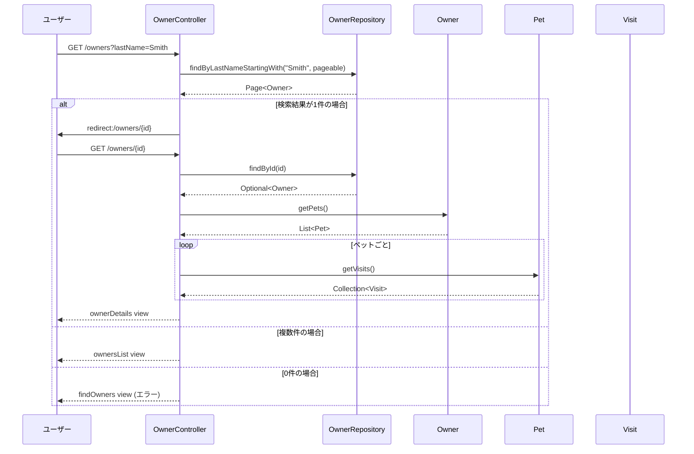
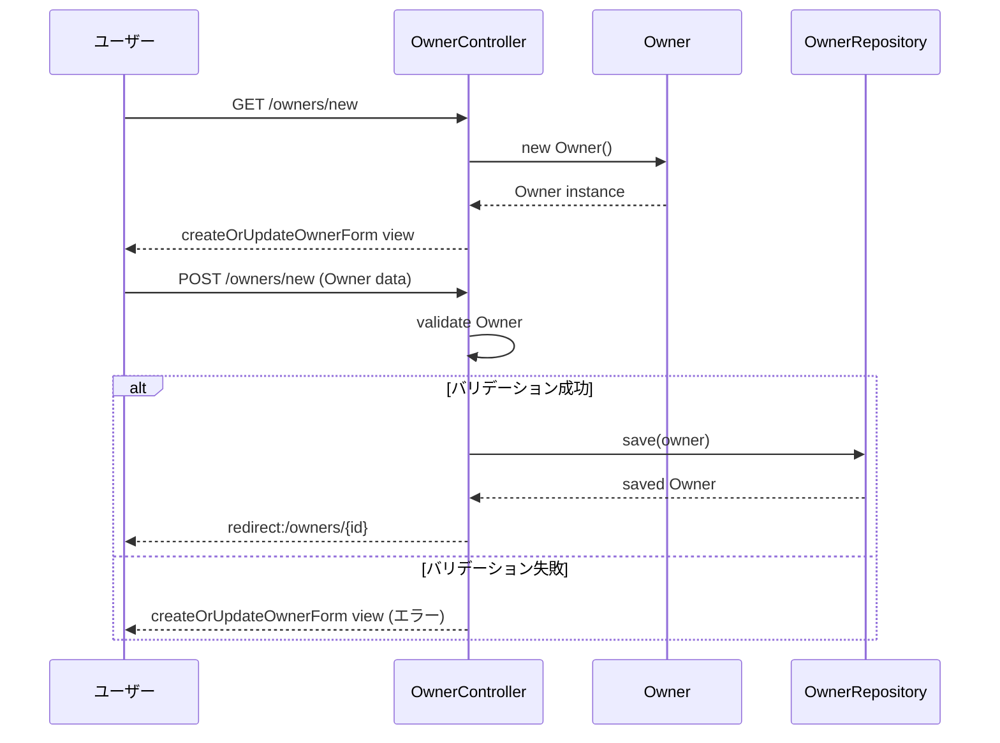
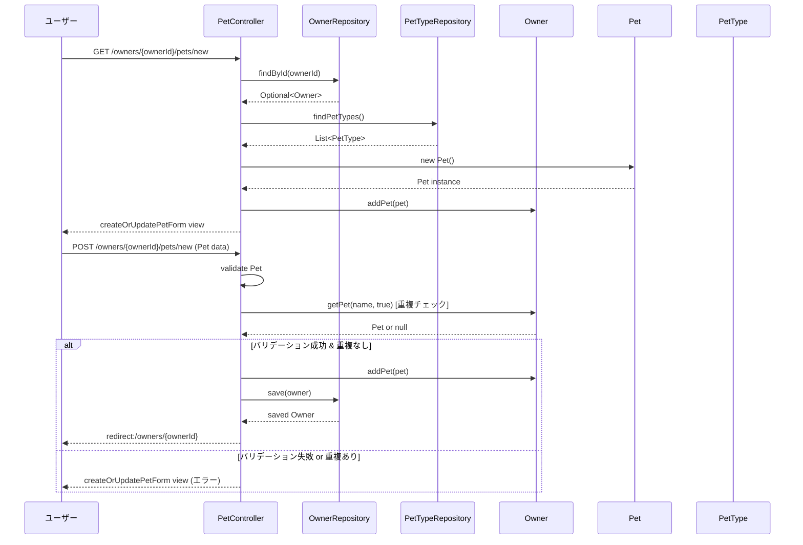
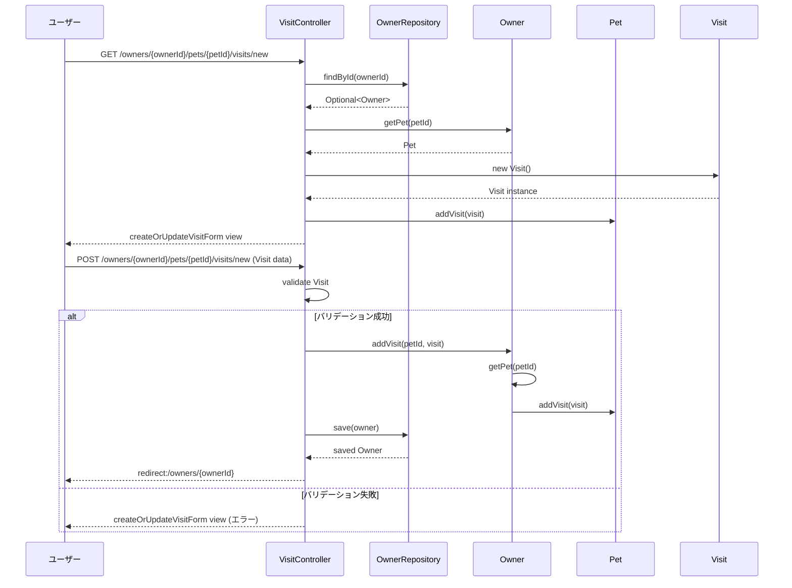
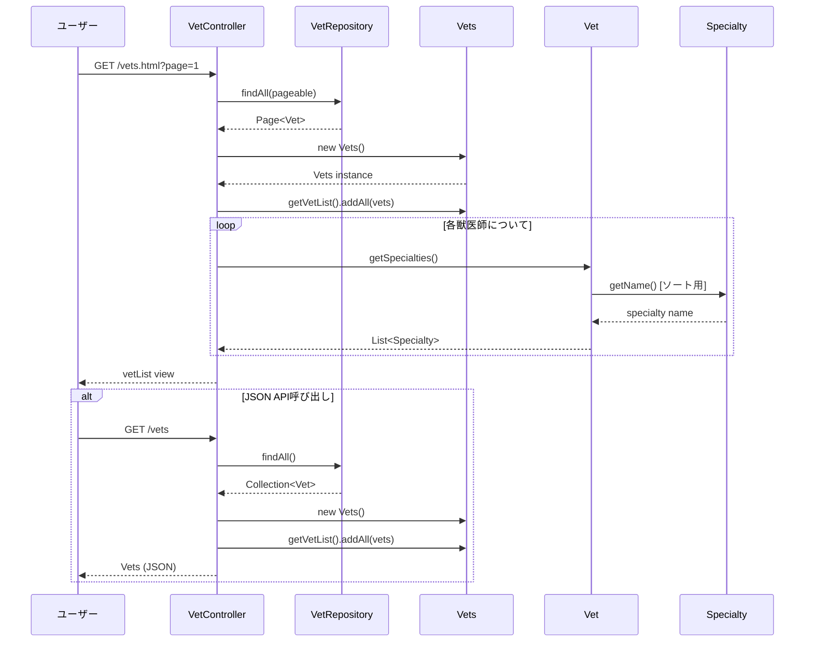
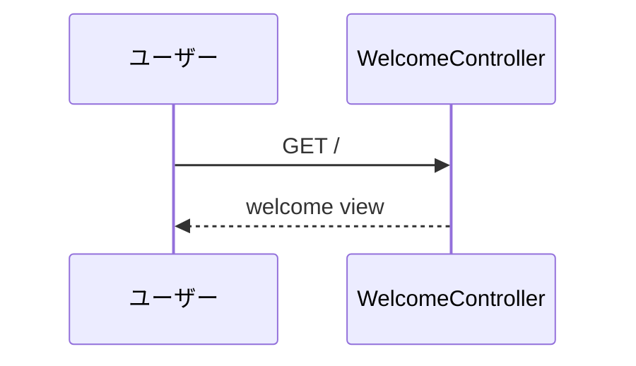

# Spring Petclinic システムシーケンス図

このドキュメントは、Spring Petclinicアプリケーションの主要なユースケースにおけるクラス間の呼び出し関係をシーケンス図で表現しています。

## 1. オーナー検索・表示のシーケンス

## 2. 新しいオーナー作成のシーケンス

## 3. ペット追加のシーケンス

## 4. 診察予約のシーケンス

## 5. 獣医師一覧表示のシーケンス

## 6. ホーム画面表示のシーケンス

## アーキテクチャ概要

このSpring Petclinicアプリケーションは、以下の層構造を持っています：

- **Controller層**: HTTP リクエストを処理し、ビジネスロジックを呼び出す
- **Repository層**: データアクセスを担当（Spring Data JPA使用）
- **Model層**: ドメインオブジェクト（Entity）を定義
- **View層**: Thymeleafテンプレートでレンダリング

### 主要なクラス関係

- `Owner` ← 1:N → `Pet` ← 1:N → `Visit`
- `Pet` ← N:1 → `PetType`
- `Vet` ← N:N → `Specialty`

### 使用されているSpring機能

- Spring MVC (Controller, RequestMapping)
- Spring Data JPA (Repository)
- Bean Validation (JSR-303)
- Thymeleaf (View Template)
- Spring Boot (Auto Configuration)